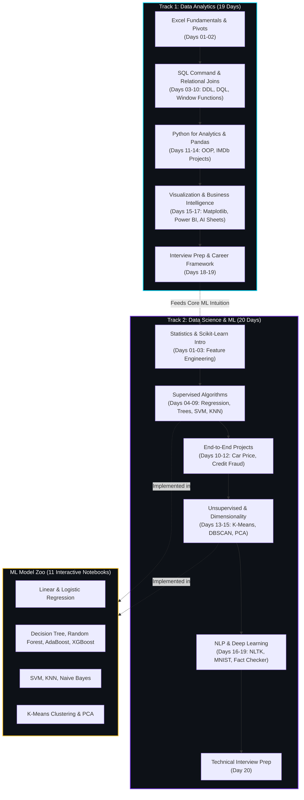

<div align="center">

<!-- Animated Typing Header -->
<a href="https://git.io/typing-svg"></a>

<br/>

<!-- Animated Wave Banner -->


<br/>

<!-- Badges Row 1: Repository Status -->


<br/>

<!-- Badges Row 2: Core Data Technologies -->


<br/>

<!-- Badges Row 3: Developer & Teaching Tooling -->


<br/><br/>

<!-- Profile Views Counter -->


</div>

---


## About This Repository

> *A complete, structured curriculum documentation repository engineered for Data Analytics, Machine Learning, and Data Science cohorts — spanning 39 immersive day-by-day modules, 11 dedicated machine learning algorithm notebooks, and over 20 real-world industry datasets.*

This repository acts as a **central knowledge base and practical lab manual**. Every single topic combines theoretical foundations, mathematical explanations, live interactive code notebooks, and real-world domain projects.

### 🌐 Live Platforms & Interactive Tools

| Platform | Description | Link |
| :--- | :--- | :---: |
| 📊 **DataVerse** | Curated interactive learning modules, live notebooks, and sandboxes across Data Science, ML, and GenAI. | [Launch Platform](https://data-verse-jayan.vercel.app/) |
| 🛠️ **AlgoArchitect** | Interactive AI data analysis and algorithm playground for exploring data workflows, visualizations, and problem-solving. | [Launch Platform](https://algoarchitect.onrender.com/) |

### Core Curriculum Highlights
* **Dual-Track Progression**: Separated into a 19-Day Data Analytics foundation and a 20-Day Advanced Data Science & Machine Learning specialization.
* **11 Hands-On Model Implementations**: Dedicated standalone Jupyter notebooks in `data science notes/models/` implementing classical algorithms (Regression, Decision Trees, Ensembles, Clustering, PCA) from raw theory to evaluation.
* **Question-and-Answer Framework**: Conceptual question prompts, interview-prep questions, and takeaway syntheses for every major domain.
* **Centralized Datasets Hub**: Over 20 benchmark datasets preserved in `datasets/` for reproducible learning and instant demonstration resets.

---


## End-to-End Curriculum Architecture



---


## Track 1: Data Analytics — 19-Day Learning Roadmap

| Day | Focus Area | Key Concepts & Projects | Primary Technologies |
| :---: | :--- | :--- | :--- |
| **01** | **Introduction to Data Analytics** | Role of a Data Analyst, industry lifecycle, project workflow | Methodologies, Analysis Mindset |
| **02** | **Excel Fundamentals & Pivots** | Advanced formulas, cell referencing, Pivot Tables on Myntra fashion dataset | Microsoft Excel, Pivot Tables |
| **03** | **SQL Basics & Excel Lookups** | Relational DB concepts, `VLOOKUP`/`XLOOKUP`, SQL vs. Excel comparisons | SQL, Microsoft Excel |
| **04** | **SQL & Excel Project Integration** | End-to-end data analysis workflow, Myntra business case study | SQL, Excel, Reporting |
| **05** | **SQL Commands Deep-Dive** | DDL, DML, and DQL query execution, schema design | PostgreSQL, MySQL, SQLite |
| **06** | **SQL Operators & Query Logic** | Comparison, logical, and pattern-matching operators, restaurant analysis | SQL Operators, Aggregations |
| **07** | **Relational SQL Joins** | `INNER`, `LEFT`, `RIGHT`, and `FULL OUTER` joins with ER relationships | Relational Algebra, SQL |
| **08** | **Advanced Multi-Table Joins** | Multi-table joins, conditional joins, and business report generation | Complex SQL Joins, Filtering |
| **09** | **SQL Subqueries & CTEs** | Correlated subqueries, scalar subqueries, Common Table Expressions | Subqueries, CTEs |
| **10** | **SQL Window Functions** | `ROW_NUMBER()`, `RANK()`, `DENSE_RANK()`, running totals on Swiggy data | Window Functions, Analytics |
| **11** | **Python Foundations** | Python syntax, data types, control flow structures, functional programming | Python 3, Jupyter |
| **12** | **Intermediate Python & NumPy** | Data structures (lists, dicts, sets), OOP fundamentals, vectorized arrays | Python OOP, NumPy |
| **13** | **Pandas Data Manipulation** | Series, DataFrames, filtering, sorting, handling nulls with IMDb data | Pandas, Data Cleaning |
| **14** | **Advanced Pandas Projects** | GroupBy aggregations, merging/joining DataFrames, feature extraction | Pandas, IMDb Analysis |
| **15** | **Data Visualization & Storytelling**| Matplotlib distributions, Seaborn heatmaps and categorical plots | Matplotlib, Seaborn |
| **16** | **Power BI Dashboarding** | Star Schema modeling, DAX measures, Books & Movies executive dashboards | Microsoft Power BI, DAX |
| **17** | **AI in Spreadsheets** | Prompt engineering for spreadsheets, Google Sheets + Gemini integrations | Generative AI, Automation |
| **18** | **Technical Interview Prep** | Data analyst technical interview problem-solving and SQL challenges | SQL, Python, Problem Solving |
| **19** | **Career Strategy & Wrap-up** | Portfolio building, GitHub profile structuring, career roadmaps | Career Strategy, Presentation |

---


## Track 2: Data Science & Machine Learning — 20-Day Learning Roadmap

| Day | Focus Area | Key Concepts & Projects | Primary Technologies |
| :---: | :--- | :--- | :--- |
| **01** | **Intro to Data Science & ML** | Supervised vs. Unsupervised, bias-variance tradeoff, ML workflow | Scikit-Learn, Statistics |
| **02** | **Scikit-Learn Framework & Stats**| Hypothesis testing, descriptive & inferential statistics, distributions | Scipy, Scikit-Learn |
| **03** | **Feature Engineering** | Missing value imputation, outlier detection (IQR/Z-score), scaling | Feature Engineering, Pandas |
| **04** | **Linear Regression** | Ordinary Least Squares (OLS), cost functions, gradient descent theory | Linear Regression, Math |
| **05** | **Logistic Regression** | Sigmoid function, cross-entropy loss, decision boundaries, ROC-AUC | Logistic Regression, Metrics |
| **06** | **Decision Trees** | Information Gain, Gini Impurity, tree pruning, classification & regression | Decision Trees, Graphviz |
| **07** | **Naive Bayes Classifiers** | Bayes' Theorem, Gaussian/Multinomial variants, text classification | Naive Bayes, Probability |
| **08** | **Support Vector Machines (SVM)** | Hyperplane optimization, hard vs. soft margins, kernel tricks (RBF) | SVM, Non-linear Classifiers |
| **09** | **K-Nearest Neighbors (KNN)** | Distance metrics (Euclidean, Manhattan), choosing optimal $k$ | KNN, Distance Metrics |
| **10** | **ML Project Setup** | Problem formulation, exploratory analysis on CarDekho vehicle dataset | EDA, Preprocessing |
| **11** | **Car Price Prediction Project** | End-to-end regression modeling, hyperparameter tuning, model deployment | Regression Pipeline |
| **12** | **Credit Card Fraud Detection** | Imbalanced classification, SMOTE resample, precision-recall optimization | Anomaly Detection, SMOTE |
| **13** | **K-Means Clustering** | Centroid initialization, Elbow method, Silhouette scoring on Mall data | K-Means, Customer Segments |
| **14** | **DBSCAN Density Clustering** | Epsilon ($\varepsilon$), MinPts, density reachability, noise point isolation | DBSCAN, Unsupervised |
| **15** | **Dimensionality Reduction (PCA)**| Eigenvectors, eigenvalues, variance retention, 30D to 2D projection | PCA, Linear Algebra |
| **16** | **NLP Foundations** | Corpus tokenization, stop-word removal, stemming, lemmatization | NLP Foundations, Regex |
| **17** | **NLP with NLTK** | TF-IDF vectorization, VADER sentiment analyzer, text mining | NLTK, Sentiment Analysis |
| **18** | **Deep Learning Foundations** | Perceptrons, activation functions, backprop, MNIST digits classifier | Neural Networks, Keras/TF |
| **19** | **Capstone Project: Fact Checker** | Multi-step NLP verification pipeline, claims classification model | Capstone Project, NLP |
| **20** | **Technical Interview Mastery** | Data Science intern & junior engineer coding interview questions | Python, ML Theory, Live Coding |

---


## 🤖 Machine Learning Model Zoo (`data science notes/models/`)

Dedicated standalone Jupyter notebooks implementing classical machine learning algorithms from scratch and via Scikit-Learn:

| Notebook | Algorithm Class | Paradigm | Benchmark Task |
| :--- | :--- | :--- | :--- |
| **[`Linear_Regression.ipynb`](data%20science%20notes/models/Linear_Regression.ipynb)** | Linear Regression | Supervised — Regression | Predict clinical diabetes progression metrics |
| **[`Logistic_Regression.ipynb`](data%20science%20notes/models/Logistic_Regression.ipynb)** | Logistic Regression | Supervised — Classification | Classify benign vs. malignant breast cancer tumors |
| **[`Decision_Tree.ipynb`](data%20science%20notes/models/Decision_Tree.ipynb)** | Decision Tree | Supervised — Classification | Multi-class Iris flower classification with tree visualization |
| **[`KNN.ipynb`](data%20science%20notes/models/KNN.ipynb)** | K-Nearest Neighbors | Supervised — Classification | Distance-based flower boundary classification |
| **[`SVM.ipynb`](data%20science%20notes/models/SVM.ipynb)** | Support Vector Machine | Supervised — Classification | Maximum margin decision boundary with RBF kernel |
| **[`Naive_Bayes.ipynb`](data%20science%20notes/models/Naive_Bayes.ipynb)** | Gaussian Naive Bayes | Supervised — Classification | Probabilistic multi-class Iris flower prediction |
| **[`Random_Forest.ipynb`](data%20science%20notes/models/Random_Forest.ipynb)** | Random Forest | Supervised — Ensemble | Bagged decision trees with feature importance scoring |
| **[`AdaBoost.ipynb`](data%20science%20notes/models/AdaBoost.ipynb)** | Adaptive Boosting | Supervised — Ensemble | Sequential weak learner boosting on cancer diagnosis |
| **[`XGBoost.ipynb`](data%20science%20notes/models/XGBoost.ipynb)** | Gradient Boosting | Supervised — Ensemble | High-performance gradient boosted decision trees |
| **[`K_Means.ipynb`](data%20science%20notes/models/K_Means.ipynb)** | K-Means | Unsupervised — Clustering | Centroid clustering with Elbow & Silhouette analysis |
| **[`PCA.ipynb`](data%20science%20notes/models/PCA.ipynb)** | Principal Component Analysis| Unsupervised — Dimensionality| Feature space compression from 30 dimensions to 2D |

---


## Centralized Datasets Hub

All raw datasets and benchmark files are stored in [`datasets/`](datasets/) for hands-on experimentation:

```
datasets/
|-- airbnb.csv                             # Global accommodation listings & rental rates
|-- CarDekho.csv                           # Used car specifications & resale valuations
|-- creditcard.zip                         # Anonymized financial fraud detection records
|-- cricbuzz.csv                           # Cricket player records and match telemetry
|-- disease_prediction.csv                 # Diagnostic symptom-to-disease mappings
|-- good_read.csv                          # 89,000+ Goodreads books metadata
|-- industrial_fault_detection_data_1000.csv # IoT sensor readings and machinery fault flags
|-- jobs.csv                               # Tech employment listings, salary & skill data
|-- movies.csv                             # 20,000+ IMDb movie titles, budgets & ratings
|-- myntra.xlsx                            # 24,324 scraped fashion catalog listings
|-- netflix_titles.csv                     # Netflix streaming catalog metadata
|-- restaurants.csv                        # 61,425 Swiggy restaurants across 500+ Indian cities
|-- Salary_Data.csv                        # Experience vs. salary regression benchmark
|-- songs.csv                              # Music track acoustic features and metadata
|-- spotify_data clean.csv                 # Spotify danceability, energy & popularity records
|-- Telco-Customer-Churn.csv               # Telecom subscription customer retention records
|-- Titanic-Dataset.csv                    # Historical passenger demographics & survival labels
|-- Travel.csv                             # Holiday package customer behavior records
|-- OpenBook/                              # 100-part book chunk dataset collection
`-- Sneaker Sales/                         # Multi-table relational schema & assignment SQL
```

---


## Repository File Structure

```
Notes/
|-- README.md                                          # Master repository documentation
|
|-- data analytics notes/                              # TRACK 1: 19-Day Data Analytics Curriculum
|   |-- Day 01/                                        # Intro to Data Analytics & workflows
|   |-- Day 02/                                        # Excel Fundamentals, Myntra Dataset
|   |-- Day 03/ - Day 10/                              # SQL Mastery (DDL, Joins, Window Functions)
|   |-- Day 11/ - Day 14/                              # Python Basics & Pandas with IMDb Projects
|   |-- Day 15/                                        # Data Visualization (Matplotlib & Seaborn)
|   |-- Day 16/                                        # Power BI Dashboarding (.pbix)
|   |-- Day 17/                                        # AI in Spreadsheets (Gemini + Sheets)
|   |-- Day 18/ - Day 19/                              # Technical Interview Prep & Career Strategy
|   `-- Temp/                                          # Scratch notebooks & experimentation
|
|-- data science notes/                                # TRACK 2: 20-Day Data Science & ML Curriculum
|   |-- models/                                        # 11 Dedicated ML Algorithm Notebooks
|   |   |-- Linear_Regression.ipynb                    # OLS regression implementation
|   |   |-- Logistic_Regression.ipynb                  # Binary classification implementation
|   |   |-- Decision_Tree.ipynb                        # Decision tree with splitting
|   |   |-- KNN.ipynb                                  # K-Nearest Neighbors classifier
|   |   |-- SVM.ipynb                                  # Support Vector Machine classifier
|   |   |-- Naive_Bayes.ipynb                          # Gaussian Naive Bayes classifier
|   |   |-- Random_Forest.ipynb                        # Bagged ensemble trees
|   |   |-- AdaBoost.ipynb                             # Adaptive boosting model
|   |   |-- XGBoost.ipynb                              # Extreme gradient boosting model
|   |   |-- K_Means.ipynb                              # Unsupervised centroid clustering
|   |   `-- PCA.ipynb                                  # Dimensionality reduction
|   |
|   `-- notes/                                         # Day-by-day lesson notes
|       |-- Day 01/ - Day 03/                          # Stats, Scikit-Learn & Feature Engineering
|       |-- Day 04/ - Day 09/                          # Core Supervised Learning Algorithms
|       |-- Day 10/ - Day 12/                          # End-to-End Projects (Car Price, Credit Fraud)
|       |-- Day 13/ - Day 15/                          # Unsupervised Learning (K-Means, DBSCAN, PCA)
|       |-- Day 16/ - Day 17/                          # NLP Foundations & NLTK Sentiment Analysis
|       |-- Day 18/                                    # Deep Learning Foundations (MNIST Digits)
|       |-- Day 19/                                    # Capstone Project: Fact Checker Engine
|       `-- Day 20/                                    # Data Science Interview Preparation
|
`-- datasets/                                          # 20+ Benchmark Datasets Hub
    |-- airbnb.csv, CarDekho.csv, creditcard.zip, ...  # CSV / XLSX benchmark files
    |-- OpenBook/                                      # Chunked book collections
    `-- Sneaker Sales/                                 # Relational SQL schema & assignments
```

---


## Quick Start & Environment Setup

### 1. Clone the Repository
```bash
git clone https://github.com/JayanGupta/Notes.git
cd Notes
```

### 2. Install Required Dependencies
```bash
pip install pandas numpy scipy matplotlib seaborn scikit-learn xgboost nltk tensorflow jupyterlab
```

### 3. Launch Jupyter Lab
```bash
jupyter lab
```

Navigate to any track or notebook (e.g., `data science notes/models/Random_Forest.ipynb`) and explore step-by-step.

---


## Contributing

Contributions, notes expansions, and bug reports are warmly welcome:

1. Fork the Project (`https://github.com/JayanGupta/Notes/fork`)
2. Create your Feature Branch (`git checkout -b feature/NewLessonNotes`)
3. Commit your Changes (`git commit -m "feat: add advanced DA notes"`)
4. Push to the Branch (`git push origin feature/NewLessonNotes`)
5. Open a Pull Request

---


## Show Your Support

Give a star if this repository helped your learning journey or classroom instruction!

<div align="center">

[](https://star-history.com/#JayanGupta/Notes&Date)

</div>

---

<div align="center">

<!-- Animated Footer Wave -->


<br/>

<b>Engineered for Data Science Education by <a href="https://github.com/JayanGupta">Jayan Gupta</a></b>

<br/><br/>


</div>
